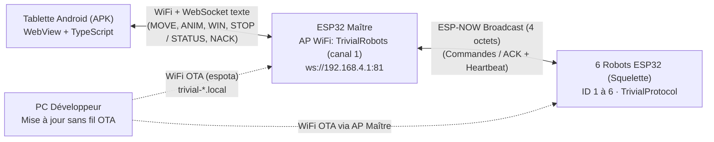

<div align="center">

# Trivial Robots

**Trivial Pursuit grandeur nature joué avec 6 robots ESP32, pilotés en temps réel depuis une tablette Android.**

[](https://github.com/Furyoisivie/trivial-robots/actions/workflows/build.yml)


-3DDC84?style=flat-square&logo=android&logoColor=white)


[Documentation détaillée](#guides-et-documentation-structurée) ·
[Squelette Robot](firmware/robot_squelette/README.md) ·
[Firmware & OTA](firmware/README.md) ·
[Protocole](firmware/lib/TrivialProtocol/README.md) ·
[APK & SDK Android](android-app/README.md)

</div>

---

## Présentation & Contexte du projet

**Trivial Robots** est un projet mené en **3e année à l'ESTIA** : un jeu de Trivial Pursuit physique où chaque pion est un robot mobile à base d'**ESP32**, piloté case par case depuis une application tablette Android.

> [!IMPORTANT]
> **Architecture pédagogique (Squelette Robot) :**
> Toute l'infrastructure technique complexe (interface tablette, génération automatisée d'APK, point d'accès WiFi, serveur WebSocket, protocole radio **ESP-NOW** avec `ACK`/retransmissions et `heartbeat`, mise à jour **OTA** sans fil) est **déjà opérationnelle**.
>
> Le code embarqué des robots est volontairement fourni sous forme de **squelette en C/C++ Arduino** ([`firmware/robot_squelette/`](firmware/robot_squelette/)) : les étudiants de l'équipe peuvent ainsi se concentrer sereinement sur l'essentiel (**le pilotage PWM des moteurs, les déplacements case par case, les pivots 90° et les animations**) sans avoir à toucher à la couche réseau.

---

## Architecture globale



---

## Guides et documentation structurée

Pour rester clair et accessible à toute l'équipe selon le rôle de chacun, la documentation est découpée en guides dédiés :

| Guide | Public cible | Contenu principal |
|---|---|---|
| [**Squelette Robot (`firmware/robot_squelette/README.md`)**](firmware/robot_squelette/README.md) | Équipe codant les robots | Guide pas à pas des 7 fonctions `TODO` en C/C++ (PWM, moteurs, `moveDir`, animations), câblage, calibration sur plateau |
| [**Firmwares & OTA (`firmware/README.md`)**](firmware/README.md) | Équipe embarquée | Compilation PlatformIO / IDE Arduino, flash USB du maître, **explication complète de l'OTA** et dépannage réseau |
| [**Protocole & `TrivialProtocol` (`firmware/lib/TrivialProtocol/README.md`)**](firmware/lib/TrivialProtocol/README.md) | Curieux / maintenance réseau | Commandes WebSocket, paquet binaire `TrPacket` (4 octets), `TrCmd`, fiabilité (`ACK`, retries, `NACK`, `HEARTBEAT`, FreeRTOS) et diagrammes |
| [**APK Android & SDK (`android-app/README.md`)**](android-app/README.md) | Équipe application / tablette | Automatisation CI/CD GitHub Actions & Gradle, **installation complète du SDK Android** (Android Studio ou CLI), signature release, dev web local |

---

## Structure du dépôt

| Dossier / Fichier | Rôle |
|---|---|
| [`web/`](web/) | Interface tablette en **TypeScript** (logique de jeu, liaison WebSocket, écrans), compilée par `esbuild` |
| [`android-app/`](android-app/) | Coquille Android : WebView plein écran qui embarque `web/dist/www` et force le trafic sur le WiFi du maître |
| [`firmware/lib/TrivialProtocol/`](firmware/lib/TrivialProtocol/) | Bibliothèque C/C++ du protocole ESP-NOW (**source unique** partagée entre maître et robots) |
| [`firmware/maitre/`](firmware/maitre/) | ESP32 maître : point d'accès WiFi, serveur WebSocket, relais ESP-NOW, suivi ACK & présence |
| [`firmware/robot_squelette/`](firmware/robot_squelette/) | ESP32 robot (**squelette à compléter**) : réseau/OTA prêts + fonctions moteur `TODO` |
| [`.github/workflows/build.yml`](.github/workflows/build.yml) | CI/CD GitHub Actions : tests web, compilation automatique de l'APK (debug/release) et des 7 firmwares ESP32 |

<details>
<summary><b>Détail de l'organisation de <code>web/src/</code></b></summary>

| Dossier / Fichier | Contenu |
|---|---|
| `web/src/game/` | Règles du Trivial Pursuit (pures, sans DOM ni réseau, couvertes par tests unitaires) + banque de 72 questions |
| `web/src/link/` | Liaison WebSocket avec le maître (`MasterLink` : reconnexion auto, keepalive `PING`/`PONG`) et formatage des commandes |
| `web/src/ui/` | Écrans (configuration des équipes, partie en cours, mode manuel) et composants d'affichage |
| `web/src/store.ts` | Persistance locale (`localStorage`) pour reprendre une partie en cas de fermeture |
| `web/src/main.ts` | Point d'entrée : assemble jeu, liaison maître et écrans |

</details>

---

## Résumé rapide des composants clés

### 1. Squelette Robot (Micro C / Arduino-ESP32)
Le fichier à compléter se trouve dans [`firmware/robot_squelette/robot/robot.ino`](firmware/robot_squelette/robot/robot.ino).
- **Déjà fonctionnel** : WiFi, ESP-NOW, OTA, clignotement LED d'identification, `heartbeat` (1 Hz), `ACK`, file FreeRTOS.
- **À implémenter** : `motorRaw` → `motorL` / `motorR` → `stopMotors` → `drive` → `forwardCell` / `turnRight90` / `turnLeft90` → `moveDir` → `animStart` / `animWin`.
- **Flash USB (PlatformIO)** :
  ```bash
  cd firmware/robot_squelette
  pio run -e robot1 -t upload      # Remplacer robot1 par robot1..robot6
  ```
**Guide complet :** [`firmware/robot_squelette/README.md`](firmware/robot_squelette/README.md).

### 2. Qu'est-ce que l'OTA (Over-The-Air) ?
> [!WARNING]
> **Statut de l'OTA :** cette fonctionnalité n'est pas encore testée à 100 % sur l'ensemble des cartes et des environnements (notamment la résolution mDNS et les mises à jour sur les 6 robots en conditions réelles). Les tests et ajustements sont à poursuivre ; en cas de souci, le flash par câble USB reste la méthode fiable de secours.

L'**OTA** (*Over-The-Air*) permet de **reprogrammer les ESP32 sans câble USB, directement par WiFi**.
- Après un **premier flash USB obligatoire**, chaque robot s'associe au WiFi `TrivialRobots` créé par le maître et expose un port réseau `ArduinoOTA` (mot de passe : `trivial-ota-2026`).
- Pendant la calibration sur le plateau, plus besoin de débrancher les robots :
  ```bash
  # PC connecté au WiFi "TrivialRobots" (mdp: trivial2026)
  cd firmware/maitre          && pio run -e maitre-ota -t upload
  cd firmware/robot_squelette && pio run -e robot3-ota -t upload
  ```
- Par sécurité, le robot appelle automatiquement `stopMotors()` dès qu'une mise à jour OTA démarre.

**Guide complet :** [`firmware/README.md`](firmware/README.md) (explications techniques, prérequis et solutions mDNS Windows).

### 3. Communication & Bibliothèque `TrivialProtocol`
- **Tablette ↔ Maître** : commandes texte sur WebSocket `ws://192.168.4.1:81` (`MOVE`, `ANIM`, `WIN`, `STOP`, `PING`), réponses synchrones (`OK`, `PONG`, `ERR ...`) et notifications temps réel (`STATUS a,b,c,d,e,f` chaque seconde, `NACK <id> <cmd>` en cas d'échec radio).
- **Maître ↔ Robots (`TrivialProtocol`)** : paquet binaire **4 octets** `{magic=0xA7, target, cmd, seq}` émis en broadcast ESP-NOW sur le canal 1 :
  - Chaque envoi est répété **3 fois** (`TR_REPEAT = 3`) et dédoublonné côté robot via `seq`.
  - Le robot répond par un `TR_CMD_ACK` ; sans réponse après `180 ms`, le maître retransmet jusqu'à **4 tentatives** avant d'avertir la tablette (`NACK`).
  - Chaque robot émet un `TR_CMD_HEARTBEAT` chaque seconde (hors-ligne après `3 s` de silence).
- **Partage du code** : `firmware/lib/TrivialProtocol/` est inclus automatiquement par PlatformIO (`lib_extra_dirs = ../lib`) dans le maître et dans le squelette robot.

**Guide complet :** [`firmware/lib/TrivialProtocol/README.md`](firmware/lib/TrivialProtocol/README.md) (anatomie complète des trames et diagrammes de séquence).

### 4. Automatisation APK & SDK Android
- **Sans rien installer (CI GitHub Actions)** : à chaque `push`, `.github/workflows/build.yml` exécute les tests TypeScript, compile l'interface web, génère l'APK Android (`TrivialRobots-debug-apk`, et `TrivialRobots-release-apk` si les secrets de signature sont configurés) ainsi que les firmwares ESP32 (`TrivialRobots-firmwares`).
- **En local** : Gradle lance automatiquement `npm ci` + `npm run build` (`esbuild`) dans `web/` puis embarque le résultat dans l'APK :
  ```bash
  cd android-app
  ./gradlew assembleDebug          # Windows : .\gradlew.bat assembleDebug
  ```
  *(Prérequis : **Node.js 22.18+**, **JDK 17** et **Android SDK API 34**.)*

**Guide complet :** [`android-app/README.md`](android-app/README.md) (installation du SDK Android via Android Studio ou CLI, signature Release et dev web).

---

## Déroulement d'une partie

1. **Allumer l'ESP32 maître** puis les robots **posés face au « haut » du plateau** (chaque robot fait clignoter sa LED `ROBOT_ID` fois).
2. **Connecter la tablette** au WiFi `TrivialRobots` (mot de passe `trivial2026`). *Si Android signale « pas d'Internet », choisir de rester connecté.*
3. Ouvrir l'application **Trivial Robots** : les pastilles en haut passent en ligne au fur et à mesure des heartbeats.
4. **Créer les équipes** (1 à 6, une par robot) puis appuyer sur **Lancer l'animation et démarrer**.
5. **À chaque tour** :
   - Lancer le dé ;
   - Déplacer le robot case par case avec les flèches directionnelles *(annulation possible)* ;
   - Indiquer la catégorie de la case d'arrivée (et cocher si c'est une case camembert) ;
   - Afficher la question et valider bonne ou mauvaise réponse.
6. **Bonne réponse** : l'équipe rejoue. **Mauvaise réponse** : tour de l'équipe suivante.
7. **Question finale** : dès qu'une équipe possède les **6 camemberts**, appuyer sur **Au centre : question finale** (catégorie choisie par les adversaires). Une bonne réponse déclenche l'animation de victoire (`WIN`) du robot gagnant.

> [!TIP]
> Le **mode manuel** (accessible depuis la barre supérieure) permet de replacer ou tester individuellement n'importe quel robot (ou `ALL`). La partie est sauvegardée automatiquement sur la tablette.

---

## Banque de questions

Les questions sont stockées dans [`web/src/game/questions.ts`](web/src/game/questions.ts) (**72 questions**, 12 par catégorie).

```ts
{ c: 0, q: "Question ?", a: "Réponse" }
```

| Indice `c` | Catégorie |
| :---: | :--- |
| `0` | Géographie |
| `1` | Divertissement |
| `2` | Histoire |
| `3` | Arts & Littérature |
| `4` | Sciences & Nature |
| `5` | Sports & Loisirs |

Les questions tirées sont mémorisées : aucune répétition tant qu'une catégorie n'a pas été entièrement épuisée.
