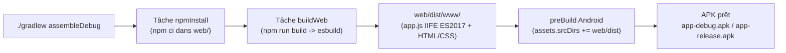
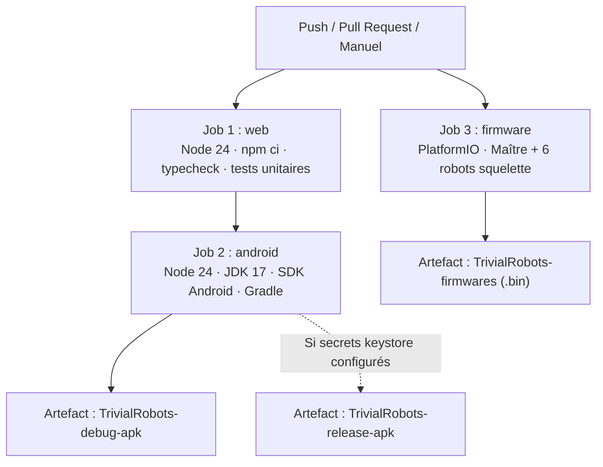

<div align="center">

# Application Android, Automatisation APK & Installation du SDK


*Comment l'APK est généré automatiquement (Gradle + GitHub Actions), comment installer le SDK Android sur ton PC et comment déployer l'application sur la tablette.*

[Retour au README principal](../README.md) · [Guide Firmware & OTA](../firmware/README.md) · [Protocole TrivialProtocol](../firmware/lib/TrivialProtocol/README.md)

</div>

---

## Sommaire

1. [Comment fonctionne l'application Android](#1-comment-fonctionne-lapplication-android)
2. [Automatisation du build APK (Gradle & GitHub Actions)](#2-automatisation-du-build-apk-gradle--github-actions)
3. [Option 1 : Récupérer l'APK sans rien installer (GitHub Actions)](#3-option-1--récupérer-lapk-sans-rien-installer-github-actions)
4. [Option 2 : Installer le SDK Android et compiler en local](#4-option-2--installer-le-sdk-android-et-compiler-en-local)
5. [Compiler un APK Release signé](#5-compiler-un-apk-release-signé)
6. [Installer l'APK sur la tablette](#6-installer-lapk-sur-la-tablette)
7. [Développer l'interface web sur PC sans tablette](#7-développer-linterface-web-sur-pc-sans-tablette)

---

## 1. Comment fonctionne l'application Android

L'application dans `android-app/` est une **coquille native Android légère** (Java, zéro dépendance externe, compatible **Android 7.0+ / `minSdk 24`**, compilée avec **`compileSdk 34`**) composée principalement de [`MainActivity.java`](app/src/main/java/fr/asso/trivialrobots/MainActivity.java) :

- **WebView plein écran immersif** : charge l'interface web embarquée localement (`file:///android_asset/www/index.html`) et maintient l'écran allumé (`FLAG_KEEP_SCREEN_ON`) pendant la partie.
- **Liaison forcée au WiFi (`bindToWifi()`)** : comme le WiFi `TrivialRobots` de l'ESP32 maître n'a **pas d'accès Internet**, Android peut refuser d'y router les paquets. `MainActivity` lie explicitement le processus de l'application au transport WiFi via `ConnectivityManager.bindProcessToNetwork(...)` pour que la connexion WebSocket `ws://192.168.4.1:81` fonctionne de façon fiable.
- **Gestion du bouton Retour** : délègue le bouton retour Android au code TypeScript (`window.onAndroidBack()`) afin d'éviter de quitter une partie par erreur.

---

## 2. Automatisation du build APK (Gradle & GitHub Actions)

La génération de l'APK est automatisée à **deux niveaux** : localement par **Gradle** et dans le cloud par **GitHub Actions**.

### 2.1 Pipeline automatisé par Gradle (`android-app/app/build.gradle`)

Tu n'as **jamais** besoin de compiler `web/` manuellement avant de compiler l'APK : Gradle s'en charge automatiquement.



- `build.mjs` utilise **esbuild** pour regrouper tout le TypeScript de `web/src/` en un unique script classique **IIFE** (`app.js`, cible `es2017` pour la compatibilité WebView en `file://`) et copier `web/public/`.
- Gradle déclare `tasks.named('preBuild') { dependsOn buildWeb }` et ajoute `web/dist` aux `assets` Android.
- Le **versionnage** est automatique : `versionCode` vaut `GITHUB_RUN_NUMBER` en CI (ou `1` en local) et `versionName` vaut `1.0.<buildNumber>`.

### 2.2 Pipeline CI/CD GitHub Actions (`.github/workflows/build.yml`)

À chaque `push`, `pull_request` ou déclenchement manuel (*Actions > Build > Run workflow*), GitHub exécute automatiquement **3 jobs** :



---

## 3. Option 1 : Récupérer l'APK sans rien installer (GitHub Actions)

Si tu veux simplement l'APK pour la tablette sans installer le SDK Android sur ton PC :

1. Pousse tes modifications sur GitHub (ou va directement sur le dépôt GitHub).
2. Ouvre l'onglet **Actions** → clique sur le dernier workflow **Build** réussi (statut vert).
3. Descends dans la section **Artifacts** en bas de la page.
4. Télécharge **`TrivialRobots-debug-apk`** (ou `TrivialRobots-release-apk` si la signature est configurée).
5. Dézippe l'archive : tu obtiens `app-debug.apk`, prêt à être copié sur la tablette.

---

## 4. Option 2 : Installer le SDK Android et compiler en local

Pour compiler l'APK directement sur ton ordinateur, il faut **3 prérequis** :
1. **Node.js 22.18+** *(utilisé par Gradle pour compiler `web/`)*, téléchargeable sur [nodejs.org](https://nodejs.org/).
2. **JDK 17** *(Java Development Kit 17, requis par Android Gradle Plugin 8.5.2)*.
3. **Android SDK** *(API 34 + Build-Tools + Platform-Tools)*.

> [!NOTE]
> Tu n'as **pas** besoin d'installer Gradle manuellement : le dépôt fournit déjà le **Gradle Wrapper** (`gradlew` / `gradlew.bat`) qui télécharge exactement Gradle `8.7`.

Choisis l'une des deux méthodes d'installation ci-dessous :

---

### Méthode A : Via Android Studio *(la plus simple, recommandée)*

Android Studio installe et configure automatiquement le **JDK 17** et le **SDK Android**.

1. **Installer Node.js 22.18+** depuis [nodejs.org](https://nodejs.org/), puis vérifier dans un terminal :
   ```bash
   node -v   # doit afficher v22.18.0 ou supérieur
   npm -v
   ```
2. **Télécharger et installer [Android Studio](https://developer.android.com/studio)** (laisser les options par défaut dans l'assistant de premier lancement pour installer l'Android SDK).
3. **Vérifier les composants SDK installés** :
   - Ouvrir Android Studio → *More Actions > SDK Manager* (ou *Settings > Languages & Frameworks > Android SDK*).
   - Onglet **SDK Platforms** : cocher **Android 14.0 ("UpsideDownCake"), API Level 34**.
   - Onglet **SDK Tools** : cocher **Android SDK Build-Tools**, **Android SDK Platform-Tools** et **Android SDK Command-line Tools**.
   - Cliquer sur **Apply** puis **OK** pour télécharger.
4. **Compiler l'APK** :
   - **Avec l'interface graphique** : *File > Open* → sélectionner le dossier `android-app/` → laisser Gradle synchroniser (première fois : 1 à 3 minutes) → menu **Build > Build Bundle(s) / APK(s) > Build APK(s)**.
   - **Ou en ligne de commande** depuis le dossier `android-app/` :
     ```powershell
     # Windows (PowerShell / CMD)
     cd android-app
     .\gradlew.bat assembleDebug
     ```
     ```bash
     # Linux / macOS
     cd android-app
     ./gradlew assembleDebug
     ```
5. **Récupérer l'APK compilé** :
   ```text
   android-app/app/build/outputs/apk/debug/app-debug.apk
   ```

---

### Méthode B : Sans Android Studio *(SDK en ligne de commande uniquement, léger)*

Utile si tu as peu d'espace disque ou si tu préfères tout faire dans VS Code / terminal.

1. **Installer Node.js 22.18+** ([nodejs.org](https://nodejs.org/)) et **JDK 17** (ex. [Eclipse Temurin 17](https://adoptium.net/temurin/releases/?version=17)).
2. **Télécharger *Command line tools only*** tout en bas de [developer.android.com/studio](https://developer.android.com/studio#command-line-tools-only).
3. **Extraire l'archive dans l'arborescence attendue par Android** *(le sous-dossier `latest` est obligatoire)* :
   - **Windows** : `C:\Android\cmdline-tools\latest\bin\sdkmanager.bat`
   - **Linux / macOS** : `~/Android/Sdk/cmdline-tools/latest/bin/sdkmanager`
4. **Définir les variables d'environnement** :

   **Windows (PowerShell) :**
   ```powershell
   [Environment]::SetEnvironmentVariable("ANDROID_HOME", "C:\Android", "User")
   # Puis redémarrer le terminal et vérifier :
   $env:ANDROID_HOME
   ```
   *(Ajoute aussi `C:\Android\platform-tools` et `C:\Android\cmdline-tools\latest\bin` dans ton `PATH` utilisateur, et vérifie que `java -version` affiche bien Java 17.)*

   **Linux / macOS (`~/.bashrc` ou `~/.zshrc`) :**
   ```bash
   export ANDROID_HOME="$HOME/Android/Sdk"
   export PATH="$PATH:$ANDROID_HOME/cmdline-tools/latest/bin:$ANDROID_HOME/platform-tools"
   ```
5. **Accepter les licences et installer les paquets du SDK** :
   ```bash
   sdkmanager --licenses
   sdkmanager "platform-tools" "platforms;android-34" "build-tools;34.0.0"
   ```
6. *(Optionnel)* Si Gradle ne détecte pas `ANDROID_HOME`, crée le fichier `android-app/local.properties` (déjà ignoré par `.gitignore`) :
   ```properties
   # Exemple Windows (double antislash ou slash normal) :
   sdk.dir=C:\\Android
   # Exemple Linux / macOS :
   # sdk.dir=/home/ton_user/Android/Sdk
   ```
7. **Compiler l'APK** :
   ```powershell
   # Windows
   cd android-app
   .\gradlew.bat assembleDebug
   ```
   ```bash
   # Linux / macOS
   cd android-app
   ./gradlew assembleDebug
   ```

---

## 5. Compiler un APK Release signé

Pour installer des mises à jour propres par-dessus une version existante sans désinstaller l'application, il faut signer l'APK avec une clé de release.

### 1. Générer la clé *(une seule fois, à conserver précieusement)*
```bash
keytool -genkeypair -keystore trivial-release.jks -alias trivial -keyalg RSA -keysize 2048 -validity 10000
```
> [!CAUTION]
> Ne commite **jamais** `trivial-release.jks` ni `keystore.properties` dans Git (ils sont déjà listés dans `.gitignore`). Sans cette clé, il est impossible de mettre à jour une application release déjà installée.

### 2. Signer en local
Créer `android-app/keystore.properties` :
```properties
storeFile=../trivial-release.jks
storePassword=TON_MOT_DE_PASSE_KEYSTORE
keyAlias=trivial
keyPassword=TON_MOT_DE_PASSE_CLE
```
Puis compiler :
```bash
cd android-app
./gradlew assembleRelease   # Windows : .\gradlew.bat assembleRelease
```
APK généré : `android-app/app/build/outputs/apk/release/app-release.apk`.

### 3. Signer automatiquement sur GitHub Actions
Dans le dépôt GitHub → *Settings > Secrets and variables > Actions*, ajouter ces 4 secrets :

| Secret GitHub | Valeur |
|---|---|
| `TR_KEYSTORE_BASE64` | Sortie de `base64 -w0 trivial-release.jks` *(PowerShell : `[Convert]::ToBase64String([IO.File]::ReadAllBytes("trivial-release.jks"))`)* |
| `TR_KEYSTORE_PASSWORD` | Mot de passe du keystore |
| `TR_KEY_ALIAS` | Alias de la clé (ex. `trivial`) |
| `TR_KEY_PASSWORD` | Mot de passe de la clé |

Dès que `TR_KEYSTORE_BASE64` est défini, le workflow produit automatiquement l'artefact `TrivialRobots-release-apk`.

---

## 6. Installer l'APK sur la tablette

### Méthode 1 : Transfert de fichier (sans ADB)
1. Copie `app-debug.apk` (ou `app-release.apk`) sur la tablette (câble USB, clé USB, mail ou téléchargement direct depuis GitHub Actions).
2. Ouvre le fichier depuis le gestionnaire de fichiers de la tablette.
3. Si Android le demande, autorise **« Installer des applications inconnues »** pour le gestionnaire de fichiers.
4. Valide l'installation.

### Méthode 2 : Via câble USB avec `adb` *(rapide pour les développeurs)*
1. Active le **Débogage USB** sur la tablette (*Paramètres > À propos > appuyer 7 fois sur Numéro de build > Options pour les développeurs > Débogage USB*).
2. Branche la tablette en USB et lance :
   ```bash
   adb devices
   adb install -r android-app/app/build/outputs/apk/debug/app-debug.apk
   ```

---

## 7. Développer l'interface web sur PC sans tablette

Tu peux modifier et tester toute l'interface de jeu (`web/`) directement dans le navigateur de ton PC :

```bash
cd web
npm install
npm run dev        # Lance http://localhost:8000 avec recompilation automatique
npm test           # Exécute les tests unitaires des règles du jeu et commandes
npm run typecheck  # Vérifie le typage TypeScript
npm run check      # typecheck + test en une commande
```

> [!TIP]
> Pour piloter de vrais robots directement depuis le navigateur de ton PC (`http://localhost:8000`), connecte simplement ton PC au WiFi `TrivialRobots` (`trivial2026`).
