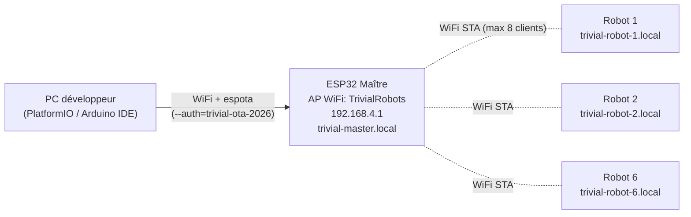

<div align="center">

# Firmwares ESP32 & Mise à jour OTA


*Guide complet de compilation, flash USB, tests série et mise à jour sans fil (**OTA**) pour l'ESP32 maître et les 6 robots.*

[Retour au README principal](../README.md) · [Guide du squelette robot](robot_squelette/README.md) · [Protocole TrivialProtocol](lib/TrivialProtocol/README.md)

</div>

---

## Sommaire

1. [Organisation du dossier `firmware/`](#1-organisation-du-dossier-firmware)
2. [Outils de compilation (PlatformIO vs IDE Arduino)](#2-outils-de-compilation-platformio-vs-ide-arduino)
3. [Flasher et tester l'ESP32 Maître](#3-flasher-et-tester-lesp32-maître)
4. [Qu'est-ce que l'OTA (Over-The-Air) ?](#4-quest-ce-que-lota-over-the-air-)
5. [Comment fonctionne l'OTA dans Trivial Robots](#5-comment-fonctionne-lota-dans-trivial-robots)
6. [Procédure de mise à jour OTA](#6-procédure-de-mise-à-jour-ota)
7. [Dépannage courant](#7-dépannage-courant)

---

## 1. Organisation du dossier `firmware/`

| Dossier | Rôle |
|---|---|
| [`maitre/`](maitre/) | **ESP32 Maître** : crée le point d'accès WiFi `TrivialRobots`, héberge le serveur WebSocket (`ws://192.168.4.1:81`), relaie les commandes en ESP-NOW, gère les ACK/retransmissions et diffuse l'état `STATUS` des robots. |
| [`robot_squelette/`](robot_squelette/) | **ESP32 Robot (squelette étudiant)** : toute la couche réseau (WiFi, ESP-NOW, OTA, heartbeat, ACK, file FreeRTOS) est prête ; seules les fonctions moteur/mouvement (`TODO`) sont à compléter. |
| [`lib/TrivialProtocol/`](lib/TrivialProtocol/) | **Bibliothèque partagée** : source unique du format de paquet ESP-NOW (`trivial_protocol.h`), partagée automatiquement entre le maître et les robots. |

> [!NOTE]
> Tous les firmwares ciblent une carte **ESP32 Dev Module** (`esp32dev`) et sont compatibles avec les cœurs **Arduino-ESP32 2.x et 3.x** (le type du callback ESP-NOW est adapté automatiquement via `#if ESP_ARDUINO_VERSION_MAJOR >= 3`).

---

## 2. Outils de compilation (PlatformIO vs IDE Arduino)

### Option A : PlatformIO *(recommandé)*

PlatformIO télécharge automatiquement la chaîne de compilation ESP32, les dépendances (`links2004/WebSockets`) et la bibliothèque locale `TrivialProtocol`. Surtout, il permet de cibler chaque robot (`robot1` à `robot6`) sans jamais modifier le code source grâce au drapeau `-DROBOT_ID=N`.

**Installation :**
- **Dans VS Code** : installer l'extension officielle **PlatformIO IDE**.
- **Ou en ligne de commande** (Python 3 requis) :
  ```bash
  pip install platformio
  ```

### Option B : IDE Arduino

Si tu préfères l'IDE Arduino classique :

1. Installer le gestionnaire de cartes **esp32 by Espressif Systems** dans *Outils > Type de carte > Gestionnaire de cartes*, puis choisir **ESP32 Dev Module**.
2. Copier le dossier [`firmware/lib/TrivialProtocol`](lib/TrivialProtocol/) dans ton dossier de bibliothèques Arduino (ex. `Documents/Arduino/libraries/TrivialProtocol`).
   > [!IMPORTANT]
   > À recopier si `trivial_protocol.h` est modifié un jour. Avec PlatformIO, ce partage est automatique.
3. Pour le **maître uniquement**, installer la bibliothèque **WebSockets** par *Markus Sattler (links2004)* via le gestionnaire de bibliothèques.
4. Ouvrir :
   - Maître : `firmware/maitre/maitre.ino`
   - Robot : `firmware/robot_squelette/robot/robot.ino` (modifier `#define ROBOT_ID` en haut du fichier pour chaque robot de `1` à `6`).

---

## 3. Flasher et tester l'ESP32 Maître

### Premier flash (par câble USB)

```bash
cd firmware/maitre
pio run -t upload        # Compile et flashe l'ESP32 maître via USB
pio device monitor       # Ouvre le moniteur série à 115200 bauds
```

Au démarrage, le moniteur série affiche :
```text
AP "TrivialRobots" sur canal 1, IP 192.168.4.1
WebSocket pret sur ws://192.168.4.1:81
OTA pret, hostname trivial-master
```

### Paramètres par défaut (`maitre.ino`)

| Paramètre | Valeur par défaut | Rôle |
|---|---|---|
| `AP_SSID` | `TrivialRobots` | Nom du réseau WiFi créé par le maître |
| `AP_PASS` | `trivial2026` | Mot de passe WiFi (8 caractères minimum) |
| `TR_WIFI_CHANNEL` | `1` | Canal radio commun (WiFi + ESP-NOW) |
| `WS_PORT` | `81` | Port du serveur WebSocket |
| `OTA_HOSTNAME` | `trivial-master` | Nom réseau mDNS (`trivial-master.local`) |
| `OTA_PASS` | `trivial-ota-2026` | Mot de passe OTA (identique sur tous les ESP32) |

> [!TIP]
> **Tester sans tablette :** tu peux piloter les robots directement depuis le moniteur série (`115200` bauds) du maître en tapant les commandes texte :
> ```text
> MOVE 1 UP
> MOVE ALL RIGHT
> ANIM
> WIN 2
> STOP ALL
> PING
> ```

---

## 4. Qu'est-ce que l'OTA (Over-The-Air) ?

> [!WARNING]
> **Fonctionnalité en cours de validation :** l'OTA n'est pas encore testée à 100 % (en particulier sur les 6 robots en parallèle et selon la configuration réseau/pare-feu des PC). Il faut continuer les tests sur matériel réel et ajuster si nécessaire. Le téléversement par câble USB reste la méthode de référence en cas d'échec.

**OTA** signifie ***Over-The-Air*** (« par les airs »). C'est un mécanisme qui permet d'envoyer un nouveau programme (firmware) dans la mémoire flash d'un ESP32 **via le WiFi**, sans avoir à le brancher en USB.

### Pourquoi est-ce indispensable pour Trivial Robots ?

Dans ce projet, il y a **1 maître + 6 robots** assemblés dans des châssis sur un plateau de jeu :
- Pendant la calibration (`CELL_MS`, `TURN90_MS`, `SPEED_L`, `SPEED_R`) et le développement du squelette robot, on modifie le code des dizaines de fois.
- Débrancher/rebrancher un câble USB sur chaque robot à chaque ajustement est long, fragile pour les connecteurs et oblige à manipuler les robots sur le plateau.
- Avec l'OTA, tu laisses tous les robots posés sur le plateau et tu mets à jour le robot n°3 (ou le maître) en une seule commande depuis ton PC en WiFi.

### Comment ça marche techniquement dans l'ESP32 ?

La mémoire flash de l'ESP32 contient deux partitions applicatives (`ota_0` et `ota_1`). Lors d'un téléversement OTA :
1. Le PC envoie le nouveau binaire `.bin` en TCP/UDP vers l'ESP32 (via la bibliothèque `ArduinoOTA`, protégée par mot de passe).
2. L'ESP32 écrit le nouveau firmware dans la partition inactive pendant que l'ancien continue de gérer la réception.
3. Une fois l'intégrité vérifiée, l'ESP32 bascule le pointeur de démarrage sur la nouvelle partition et redémarre automatiquement sur le nouveau code.

> [!WARNING]
> **Le tout premier flash DOIT obligatoirement se faire par câble USB.**
> Un ESP32 neuf ne contient pas encore `ArduinoOTA` ni les identifiants WiFi `TrivialRobots`. Une fois flashé une première fois par USB avec le firmware du projet, toutes les mises à jour suivantes pourront se faire en OTA.

---

## 5. Comment fonctionne l'OTA dans Trivial Robots

Dans Trivial Robots, il n'y a pas besoin de box Internet ni de routeur externe : **l'ESP32 maître joue lui-même le rôle de point d'accès WiFi**.



Voici exactement ce qui se passe au démarrage de chaque carte :

1. **ESP32 Maître** (`WIFI_AP_STA`) :
   - Crée le réseau WiFi `TrivialRobots` (mot de passe `trivial2026`) sur le **canal 1**, avec une limite de **8 clients simultanés** (1 tablette + 6 robots + 1 PC ou marge).
   - Lance `ArduinoOTA` avec le nom mDNS `trivial-master.local`.
2. **Chaque Robot** (`WIFI_STA`) :
   - Au `setup()`, tente de se connecter au WiFi `TrivialRobots` pendant **5 secondes maximum** (`wifiDeadline`).
   - **Si le maître est allumé** : le robot obtient une adresse IP (ex. `192.168.4.2`) et s'aligne automatiquement sur le canal 1 du maître. **ESP-NOW et OTA fonctionnent alors simultanément.**
   - **Si le maître est éteint** : au bout de 5 s, le robot ne bloque pas ; il force le canal radio `1` (`esp_wifi_set_channel`) pour qu'ESP-NOW reste opérationnel dès que le maître démarrera, et `WiFi.setAutoReconnect(true)` se chargera de se reconnecter au WiFi plus tard.
   - Publie son nom mDNS `trivial-robot-<ID>.local` (ex. `trivial-robot-3.local`).
3. **Sécurité matérielle pendant l'OTA** :
   - Dès qu'une mise à jour OTA démarre sur un robot, le callback `ArduinoOTA.onStart` appelle immédiatement `stopMotors()` pour éviter que le robot ne continue de rouler pendant le flashage.
   - Dans `loop()`, `ArduinoOTA.handle()` est appelé en permanence (grâce au timeout court de 50 ms sur la file `cmdQueue`).

---

## 6. Procédure de mise à jour OTA

### Prérequis avant de lancer un flash OTA

- [x] L'ESP32 cible a déjà été flashé **au moins une fois par USB**.
- [x] L'**ESP32 maître est allumé** (il diffuse le WiFi `TrivialRobots`).
- [x] Le **PC est connecté au WiFi `TrivialRobots`** (mot de passe : `trivial2026`).
- [x] Le(s) robot(s) à mettre à jour sont **allumés** et associés au WiFi du maître.

### Flasher via PlatformIO (recommandé)

**Mettre à jour l'ESP32 maître :**
```bash
cd firmware/maitre
pio run -e maitre-ota -t upload
```

**Mettre à jour un robot (remplacer `3` par `1` à `6`) :**
```bash
cd firmware/robot_squelette
pio run -e robot3-ota -t upload
```

> [!TIP]
> Tu peux aussi sélectionner l'environnement `robot3-ota` directement dans la barre inférieure de VS Code (icône PlatformIO), puis cliquer sur **Upload (→)**.

### Flasher via l'IDE Arduino

1. Connecte ton PC au WiFi `TrivialRobots`.
2. Dans l'IDE Arduino, va dans *Outils > Port* → section **Ports réseau**.
3. Sélectionne `trivial-master at 192.168.4.1` ou `trivial-robot-X at 192.168.4.X`.
4. Clique sur **Téléverser** et saisis le mot de passe OTA : `trivial-ota-2026`.

### Tableau récapitulatif des cibles OTA

| Carte | Environnement USB | Environnement OTA | Hostname mDNS | IP typique |
|---|---|---|---|---|
| Maître | `maitre` | `maitre-ota` | `trivial-master.local` | `192.168.4.1` |
| Robot 1 | `robot1` | `robot1-ota` | `trivial-robot-1.local` | `192.168.4.x` |
| Robot 2 | `robot2` | `robot2-ota` | `trivial-robot-2.local` | `192.168.4.x` |
| Robot 3 | `robot3` | `robot3-ota` | `trivial-robot-3.local` | `192.168.4.x` |
| Robot 4 | `robot4` | `robot4-ota` | `trivial-robot-4.local` | `192.168.4.x` |
| Robot 5 | `robot5` | `robot5-ota` | `trivial-robot-5.local` | `192.168.4.x` |
| Robot 6 | `robot6` | `robot6-ota` | `trivial-robot-6.local` | `192.168.4.x` |

---

## 7. Dépannage courant

<details>
<summary><b>Erreur OTA : « No response from device » ou hostname <code>.local</code> introuvable (Windows)</b></summary>

Sur Windows sans service **Bonjour** (mDNS), les noms en `.local` peuvent ne pas être résolus.
- **Solution 1 (rapide)** : remplacer `upload_port` par l'adresse IP directe (ex. `192.168.4.1` pour le maître, ou l'IP affichée au démarrage du robot sur son port série : `WiFi OK, IP 192.168.4.2, canal 1`), ou passer l'IP en ligne de commande sans modifier `platformio.ini` :
  ```bash
  pio run -e robot3-ota -t upload --upload-port 192.168.4.2
  ```
- **Solution 2** : installer *Bonjour Print Services* pour Windows afin de résoudre automatiquement tous les `.local`.
- Vérifie également que le **pare-feu Windows** autorise Python / `espota.py` sur le réseau privé `TrivialRobots` (l'ESP32 ouvre une connexion retour vers le PC pendant l'OTA).

</details>

<details>
<summary><b>L'OTA échoue avec « Auth Failed »</b></summary>

Le mot de passe OTA (`trivial-ota-2026`) doit être **strictement identique** entre :
- `OTA_PASS` dans `maitre.ino` et `robot.ino` ;
- `upload_flags = --auth=...` dans les deux fichiers `platformio.ini`.

</details>

<details>
<summary><b>Le robot n'apparaît pas sur le réseau après un flash OTA raté</b></summary>

Si un mauvais code (par exemple une boucle infinie dans une fonction `TODO` qui empêche d'atteindre `ArduinoOTA.handle()`) bloque l'OTA :
- Il suffit de rebrancher le robot en **USB** et de relancer un flash filaire (`pio run -e robotX -t upload`). L'USB reste toujours disponible en secours.

</details>
