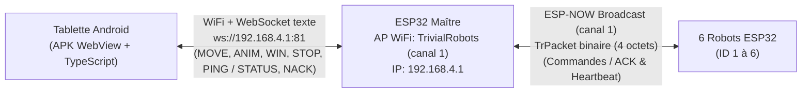
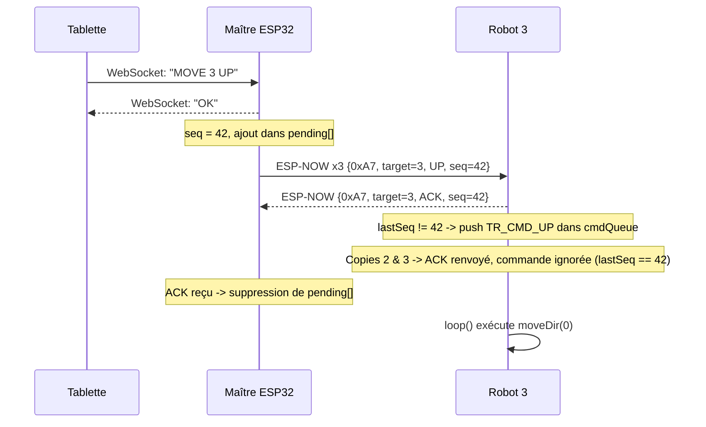
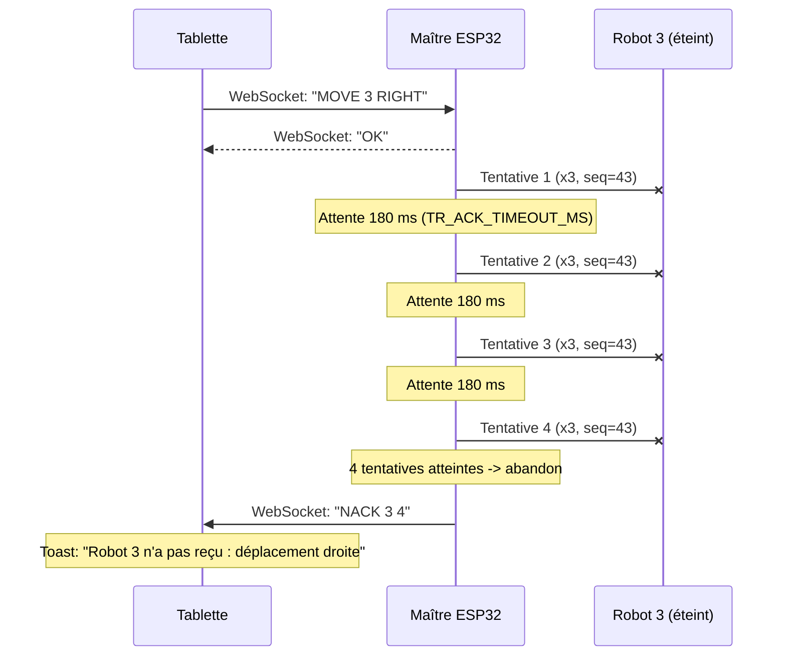
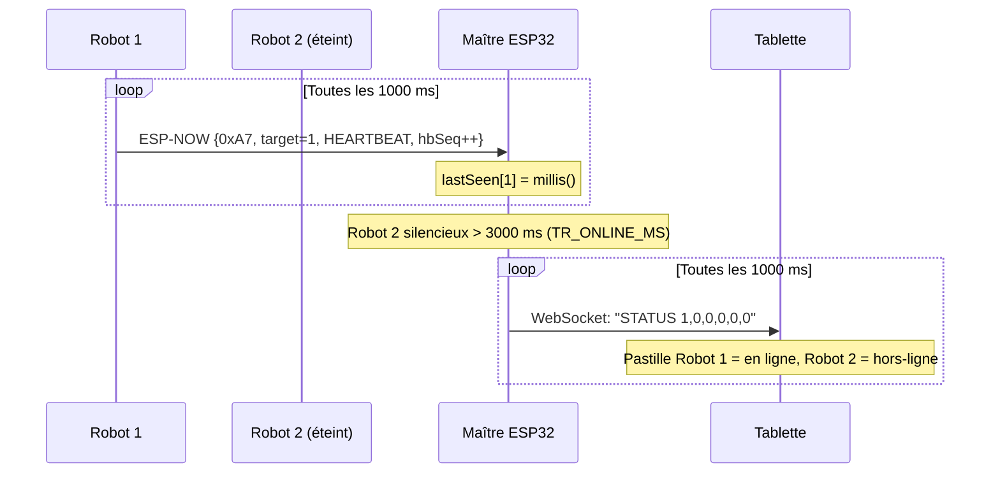

<div align="center">

# Protocole de Communication & Bibliothèque `TrivialProtocol`


*Architecture réseau complète de bout en bout (Tablette ↔ ESP32 Maître ↔ 6 Robots) et fonctionnement interne de la librairie partagée `TrivialProtocol`.*

[Retour au README principal](../../../README.md) · [Guide Firmware & OTA](../../README.md) · [Guide du squelette robot](../../robot_squelette/README.md)

</div>

---

## Sommaire

1. [Vue d'ensemble de l'architecture réseau](#1-vue-densemble-de-larchitecture-réseau)
2. [Couche 1 : Tablette ↔ ESP32 Maître (WiFi & WebSocket)](#2-couche-1--tablette--esp32-maître-wifi--websocket)
3. [Couche 2 : ESP32 Maître ↔ Robots (ESP-NOW & `TrivialProtocol`)](#3-couche-2--esp32-maître--robots-esp-now--trivialprotocol)
4. [Anatomie de la librairie `TrivialProtocol`](#4-anatomie-de-la-librairie-trivialprotocol)
5. [Mécanismes de fiabilité & Diagrammes de séquence](#5-mécanismes-de-fiabilité--diagrammes-de-séquence)
6. [Comment la librairie est intégrée dans les projets](#6-comment-la-librairie-est-intégrée-dans-les-projets)

---

## 1. Vue d'ensemble de l'architecture réseau

La communication dans **Trivial Robots** repose sur **deux liaisons sans fil distinctes** reliées par l'ESP32 Maître qui joue le rôle de passerelle :



| Liaison | Technologie | Format des messages | Rôle |
|---|---|---|---|
| **Tablette ↔ Maître** | WiFi AP + WebSocket (port `81`) | Texte UTF-8 lisible (`MOVE 1 UP`, `STATUS ...`) | Pilotage depuis l'interface web/APK, affichage en temps réel des robots en ligne et alertes d'erreur |
| **Maître ↔ Robots** | **ESP-NOW** en broadcast (`FF:FF:FF:FF:FF:FF`) sur le canal `1` | Structure binaire **`TrPacket` de 4 octets** | Transmission ultra-rapide et légère vers 1 ou 6 robots sans surcharge TCP/IP |

> [!NOTE]
> **Pourquoi deux protocoles différents ?**
> Une tablette Android ne sait pas parler ESP-NOW nativement : elle communique donc en **WebSocket** sur le WiFi créé par le maître. En revanche, entre le maître et les 6 robots, **ESP-NOW** offre une latence de l'ordre de la milliseconde, fonctionne en broadcast vers tous les robots simultanément et cohabite sur le même canal radio (`canal 1`) que le WiFi utilisé pour l'OTA.

---

## 2. Couche 1 : Tablette ↔ ESP32 Maître (WiFi & WebSocket)

### 2.1 Connexion WiFi et particularité Android
- L'ESP32 maître crée un point d'accès local (`WiFi.softAP`) :
  - **SSID** : `TrivialRobots`
  - **Mot de passe** : `trivial2026`
  - **IP du maître** : `192.168.4.1` (port WebSocket : `81`)
  - **Capacité** : 8 stations simultanées (1 tablette + 6 robots pour l'OTA + 1 marge/PC).
- Comme ce réseau n'a **pas d'accès Internet**, Android a tendance à rediriger les requêtes réseau vers la 4G/5G ou à ignorer le WiFi. L'application Android (`MainActivity.java`) appelle `ConnectivityManager.bindProcessToNetwork(...)` afin de forcer tout le trafic de la WebView sur le WiFi `TrivialRobots`.

### 2.2 Cycle de vie WebSocket (`MasterLink`)
Géré côté tablette dans [`web/src/link/master-link.ts`](../../../web/src/link/master-link.ts) et côté maître dans [`firmware/maitre/maitre.ino`](../../maitre/maitre.ino) :

1. **Ouverture (`WStype_CONNECTED`)** : dès qu'une tablette se connecte sur `ws://192.168.4.1:81`, le maître lui envoie immédiatement :
   - `HELLO TRIVIAL-MASTER 1`
   - `STATUS a,b,c,d,e,f` (état initial instantané des 6 robots)
2. **Keepalive (`PING` / `PONG`)** : la tablette envoie `PING` toutes les **4 secondes** (`PING_MS = 4000`). Le maître répond `PONG`.
3. **Détection de coupure & reconnexion** : si la tablette ne reçoit aucun message pendant **10 secondes** (`RX_TIMEOUT_MS = 10000`), elle ferme la socket et tente de se reconnecter automatiquement toutes les **2 secondes** (`RETRY_MS = 2000`).

### 2.3 Commandes texte (Tablette → Maître)
Le maître met la commande en majuscules (`trim()` + `toUpperCase()`), elle est donc insensible à la casse. Les mêmes commandes fonctionnent sur le **moniteur série USB** du maître (115200 bauds).

| Commande | Arguments | Effet |
|---|---|---|
| `MOVE <cible> <dir>` | `cible` = `1`..`6` ou `ALL`<br>`dir` = `UP` \| `DOWN` \| `LEFT` \| `RIGHT` | Déplace le(s) robot(s) d'**1 case** dans la direction absolue (repère plateau) |
| `ANIM [cible]` | `1`..`6` ou `ALL` *(vide = `ALL`)* | Lance l'animation de début de partie |
| `WIN [cible]` | `1`..`6` ou `ALL` *(vide = `ALL`)* | Lance l'animation de victoire |
| `STOP [cible]` | `1`..`6` ou `ALL` *(vide = `ALL`)* | Arrêt d'urgence + vidage immédiat de la file de commandes du robot |
| `PING` | *(aucun)* | Keepalive : le maître répond `PONG` |

### 2.4 Réponses et notifications (Maître → Tablette)

**Réponses synchrones (suite à une commande) :**
- `OK` : commande valide et transmise en ESP-NOW.
- `PONG` : réponse au `PING`.
- `ERR bad MOVE` / `ERR bad target` / `ERR espnow` / `ERR unknown` : erreur affichée dans un toast sur la tablette.

**Messages asynchrones (poussés automatiquement par le maître) :**

| Message | Fréquence / Déclencheur | Signification |
|---|---|---|
| `STATUS a,b,c,d,e,f` | Toutes les **1 s** + à chaque nouvelle connexion | État des robots `1` à `6` (`1` = en ligne, `0` = hors-ligne). Exemple : `STATUS 1,0,1,1,0,0` |
| `NACK <id> <cmd>` | Après échec des 4 tentatives ESP-NOW | Le robot `<id>` n'a jamais acquitté la commande `<cmd>` (opcode `1..7` de `TrCmd`). La tablette affiche : *« Robot X n'a pas reçu : … »* |

---

## 3. Couche 2 : ESP32 Maître ↔ Robots (ESP-NOW & `TrivialProtocol`)

Tous les échanges radio entre le maître et les robots utilisent l'adresse MAC de broadcast `FF:FF:FF:FF:FF:FF` sur le canal `TR_WIFI_CHANNEL` (`1`), sans chiffrement (inutile sur ce réseau local de jeu et plus simple sans appairage MAC individuel).

> [!TIP]
> **Zéro configuration d'adresse MAC :**
> Grâce au broadcast + champ `target` dans `TrPacket`, tu peux remplacer un ESP32 grillé par un neuf sans jamais recopier d'adresse MAC dans le code du maître : il suffit de flasher le nouvel ESP32 avec son `ROBOT_ID` (`1` à `6`).

---

## 4. Anatomie de la librairie `TrivialProtocol`

La bibliothèque [`firmware/lib/TrivialProtocol`](.) est la **source unique de vérité** partagée par le maître et les robots. Elle ne contient qu'un fichier d'en-tête léger (`src/trivial_protocol.h`) et un descripteur standard (`library.properties`).

### 4.1 Structure du paquet binaire `TrPacket` (4 octets)

```c
typedef struct __attribute__((packed)) {
  uint8_t magic;   // Octet 0 : signature fixe TR_MAGIC (0xA7)
  uint8_t target;  // Octet 1 : destinataire (Maître -> Robot) ou émetteur (Robot -> Maître)
  uint8_t cmd;     // Octet 2 : opcode de l'énumération TrCmd (1..9)
  uint8_t seq;     // Octet 3 : numéro de séquence (0..255)
} TrPacket;
```

```text
+------------------+------------------+------------------+------------------+
|  Octet 0: magic  | Octet 1: target  |   Octet 2: cmd   |   Octet 3: seq   |
|      0xA7        | 1..6 ou 0xFF     |   TrCmd (1..9)   |     0..255       |
+------------------+------------------+------------------+------------------+
                         Total : 4 octets exacts (packed)
```

| Champ | Sens Maître → Robot | Sens Robot → Maître (`HEARTBEAT` / `ACK`) |
|---|---|---|
| `magic` | Toujours `0xA7` (`TR_MAGIC`). Permet d'ignorer instantanément tout paquet ESP-NOW étranger. | Toujours `0xA7` (`TR_MAGIC`). |
| `target` | ID du robot ciblé (`1..6`) ou `0xFF` (`TR_TARGET_ALL`) pour tous les robots. | **ID source** du robot qui émet (`1..6`), pour que le maître sache qui lui répond. |
| `cmd` | Commande à exécuter (`1..7`). | `8` (`TR_CMD_HEARTBEAT`) ou `9` (`TR_CMD_ACK`). |
| `seq` | Compteur incrémental du maître (initialisé aléatoirement via `esp_random()` au boot). | Compteur de heartbeat (`hbSeq`), ou **copie exacte du `seq` reçu** dans le cas d'un `TR_CMD_ACK`. |

### 4.2 Constantes de configuration (`trivial_protocol.h`)

| Constante | Valeur | Rôle |
|---|---|---|
| `TR_WIFI_CHANNEL` | `1` | Canal radio WiFi commun (AP du maître + ESP-NOW) |
| `TR_MAGIC` | `0xA7` | Octet magique d'identification des paquets Trivial Robots |
| `TR_TARGET_ALL` | `0xFF` | Valeur de `target` pour s'adresser aux 6 robots à la fois |
| `TR_REPEAT` | `3` | Nombre d'émissions consécutives par salve (espacées de `4 ms`) |
| `TR_ROBOT_COUNT` | `6` | Nombre de robots gérés sur le plateau |
| `TR_HEARTBEAT_MS` | `1000` | Période d'émission du heartbeat robot (1 s) et du `STATUS` maître |
| `TR_ONLINE_MS` | `3000` | Durée de silence au-delà de laquelle un robot passe hors-ligne (3 s) |
| `TR_ACK_TIMEOUT_MS` | `180` | Délai d'attente d'un `ACK` avant retransmission par le maître (`180 ms`) |
| `TR_ACK_MAX_TRIES` | `4` | Nombre maximal d'envois (1er envoi + 3 retries) avant abandon (`NACK`) |

### 4.3 Table des opcodes (`enum TrCmd`)

| Valeur | Nom | Sens | Description |
| :---: | :--- | :---: | :--- |
| `1` | `TR_CMD_UP` | Maître → Robot | Avancer d'1 case vers le **haut** du plateau (`dir = 0`) |
| `2` | `TR_CMD_DOWN` | Maître → Robot | Avancer d'1 case vers le **bas** du plateau (`dir = 2`) |
| `3` | `TR_CMD_LEFT` | Maître → Robot | Avancer d'1 case vers la **gauche** du plateau (`dir = 3`) |
| `4` | `TR_CMD_RIGHT` | Maître → Robot | Avancer d'1 case vers la **droite** du plateau (`dir = 1`) |
| `5` | `TR_CMD_ANIM` | Maître → Robot | Lancer l'animation de début de partie (`animStart()`) |
| `6` | `TR_CMD_STOP` | Maître → Robot | Arrêt immédiat (`stopMotors()`) + vidage de la file `cmdQueue` |
| `7` | `TR_CMD_WIN` | Maître → Robot | Lancer l'animation de victoire (`animWin()`) |
| `8` | `TR_CMD_HEARTBEAT` | Robot → Maître | Signal de présence « je suis en ligne » (`target = ROBOT_ID`) |
| `9` | `TR_CMD_ACK` | Robot → Maître | Accusé de réception d'une commande (`target = ROBOT_ID`, `seq` échoé) |

---

## 5. Mécanismes de fiabilité & Diagrammes de séquence

Le broadcast ESP-NOW ne garantit pas nativement la livraison des paquets. `TrivialProtocol` + le maître + les robots implémentent donc **5 protections complémentaires** :

1. **Triple émission en rafale (`TR_REPEAT = 3`)** : chaque envoi émet 3 paquets identiques espacés de `4 ms` pour absorber les micro-interférences radio.
2. **Dédoublonnage par numéro de séquence (`seq`)** : le robot mémorise `lastSeq`. Si les copies 2 et 3 arrivent aussi, il ne ré-exécute jamais le mouvement. Au démarrage, le maître initialise `seqNum = esp_random()` pour éviter de tomber sur le même `seq` après un redémarrage.
3. **Accusé de réception (`ACK`) & Retransmissions automatiques** :
   - À chaque paquet reçu (y compris les doublons, au cas où son premier `ACK` aurait été perdu), le robot répond immédiatement `TR_CMD_ACK` avec le même `seq`.
   - Pour toute commande **ciblée** (hors `ALL`), le maître enregistre la commande dans sa table `pending[8]`. Sans `ACK` au bout de `180 ms`, il renvoie une salve de 3 paquets jusqu'à `4` tentatives totales. En cas d'échec final, il envoie `NACK <id> <cmd>` à la tablette.
4. **Détection de présence temps réel (`HEARTBEAT` → `STATUS`)** :
   - Chaque robot envoie `TR_CMD_HEARTBEAT` toutes les secondes. La réception d'un `ACK` met également à jour `lastSeen[id]`.
   - Si un robot reste silencieux plus de `3000 ms`, le maître passe son bit à `0` dans le message `STATUS` diffusé chaque seconde à la tablette.
5. **File FreeRTOS non bloquante (`cmdQueue`)** :
   - Le callback ESP-NOW (`onRecv` → `handlePacket`) s'exécute dans la tâche WiFi : il ne bloque **jamais** et pousse simplement l'opcode dans une file FreeRTOS de 16 places (`xQueueSend(..., 0)`).
   - La `loop()` dépile les commandes une par une pour exécuter les mouvements.
   - En cas de `TR_CMD_STOP`, le callback appelle immédiatement `xQueueReset(cmdQueue)` pour annuler toutes les commandes en attente avant d'empiler l'arrêt.

### Scénario A : Commande nominale avec `ACK` et dédoublonnage



### Scénario B : Robot hors de portée / éteint (Retries → `NACK`)



### Scénario C : Détection de présence (`HEARTBEAT` → `STATUS`)



---

## 6. Comment la librairie est intégrée dans les projets

| Environnement | Comment `TrivialProtocol` est chargée |
|---|---|
| **PlatformIO** *(automatique)* | Les fichiers `firmware/maitre/platformio.ini` et `firmware/robot_squelette/platformio.ini` déclarent tous les deux :<br>`lib_extra_dirs = ../lib`<br>PlatformIO détecte automatiquement `TrivialProtocol` grâce à `library.properties` et résout `#include <trivial_protocol.h>`. Toute modification de `trivial_protocol.h` est immédiatement visible par le maître et les 6 robots. |
| **IDE Arduino** *(manuel)* | Copier le dossier `firmware/lib/TrivialProtocol` dans `Documents/Arduino/libraries/TrivialProtocol`, puis redémarrer l'IDE Arduino. Penser à recopier le dossier si le protocole évolue. |
